# LangGraph Reflexion Agent: Self-Critique, Research and Checked Citations

[](https://github.com/<your-user>/langgraph-reflexion-agent/actions/workflows/tests.yml)


A **Reflexion** research agent built with **LangGraph 1.x**. The agent:

1. drafts an answer;
2. critiques it: what is missing, what is superfluous;
3. writes search queries;
4. searches a knowledge base;
5. revises the answer with **numbered citations**.

Then it checks the revision in code:

- every reference must be a source the search **actually returned**;
- every citation number must point to a reference;
- the answer must stay within the word limit.

Failed checks go back to the model with the next search results. The loop ends when the answer is complete or the revision budget is used up, and it can't spin forever.

The topic is **testing LLM applications**: prompt injection, evals, LLM-as-judge, flaky tests, RAG evaluation and more. Answers come from a small, free, local knowledge base, searched with BM25. Every note has a stable source id such as `kb://prompt-injection-testing`.

It runs on **Google Gemini** (free API tier), **OpenAI**, or a built-in **offline mode** that needs no key and costs nothing.

> Portfolio version of the lab *"Building a Reflection Agent with External Knowledge Integration"* (the Reflexion lab) from IBM's **Agentic AI with LangChain and LangGraph** course (Coursera), re-implemented as a tested, installable package. See [Credits](#credits).

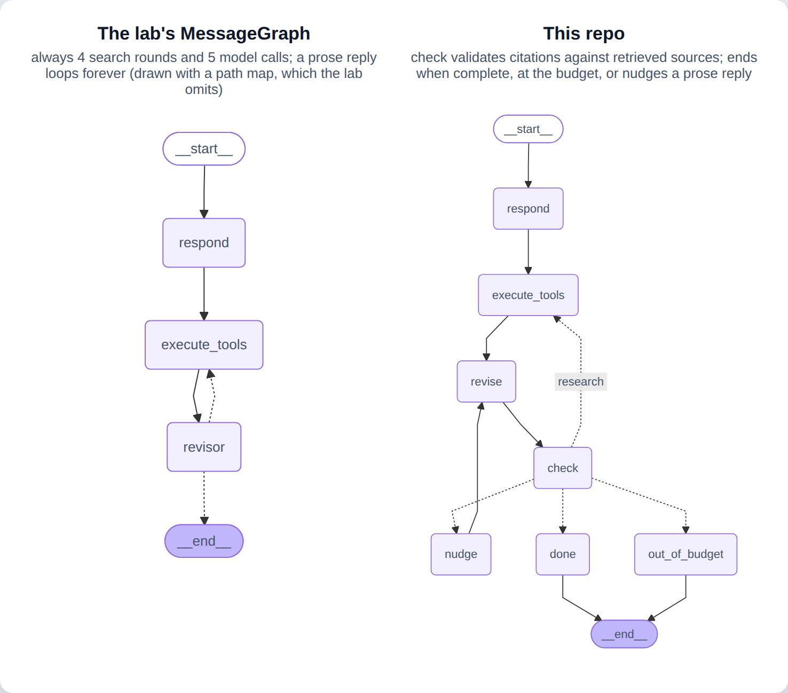

*Drawn from each compiled graph's own Mermaid export (`app.get_graph().draw_mermaid()`). Dotted edges are conditional.*

---

## Contents

- [Changes from the original lab](#changes-from-the-original-lab)
- [What the lab asks you to do](#what-the-lab-asks-you-to-do)
- [Features](#features)
- [Quick start (free)](#quick-start-free)
- [How it works](#how-it-works)
- [Evaluation](#evaluation)
- [Usage](#usage): CLI · Python API · notebook
- [Testing](#testing)
- [Project structure](#project-structure)
- [Configuration](#configuration)
- [Lessons learned](#lessons-learned)
- [Credits](#credits)

## Changes from the original lab

* **Newer LangGraph:** a `StateGraph` with typed state (`add_messages`, counters, retrieved sources), `START`/`END` and an optional SQLite checkpointer. The lab used `MessageGraph`, which is deprecated in LangGraph 1.0. The lab's graph is still included as runnable code ([`lab_pattern.py`](src/reflexion_agent/lab_pattern.py)), with a screenshot of how it behaves.
* **Gemini by default:** it uses a free Gemini API key, and OpenAI and offline mode are also built in. The lab used `gpt-5-nano` (its text says GPT-4o-mini).
* **Own data and topic:** 12 short notes I wrote on testing LLM applications ([`data/knowledge_base/`](data/knowledge_base)), plus 12 research questions, each with the note a good answer should cite ([`data/questions.jsonl`](data/questions.jsonl)).
  * The lab's topic was diet advice. Its persona role-played two real, named public figures giving one-sided advice to a user who says they are pre-diabetic with heart problems. That isn't reproduced here; the persona is a neutral QA engineer.
* **Free resources:** BM25 search over local Markdown replaces the paid Tavily web search. Tavily is still available as an option (`--search tavily`, via the maintained `langchain-tavily` package). Checkpoints can go to a local **SQLite** file.
* **Fixes:**
  * **The loop always ends.** The lab's stop rule counted `ToolMessage`s. If the revisor answered in prose, nothing was counted and the revisor was called again and again until `GraphRecursionError`. With LangGraph 1.x's default limit of 10,007 steps, that's about 5,000 paid calls. Here every revision counts against `max_revisions`, and a prose reply gets a nudge back to the tool.
  * **It stops when it's done.** The lab always ran 4 search rounds and 5 model calls. Here the loop ends as soon as the checks pass and the model's critique says nothing is missing: 3 model calls in the offline eval.
  * **Citations are checked.** The lab asked for numbered citations and a References section but never verified them. Here every reference must be a retrieved source, citation numbers must match, and failures are sent back as feedback.
  * **The history stays small.** Search results are trimmed to 500 characters per passage, and at most 3 queries run per round. The lab kept every raw result in the history, so each round sent a longer prompt.

## What the lab asks you to do

| Lab step | What you build | Where it lives here |
|---|---|---|
| Search tool | `TavilySearchResults` web search | [`knowledge.py`](src/reflexion_agent/knowledge.py) `KnowledgeBase` (BM25, free); `TavilySource` optional |
| Prompt and persona | One template, a different first instruction per role | [`prompts.py`](src/reflexion_agent/prompts.py), with a neutral persona |
| Responder | `AnswerQuestion` (answer, `Reflection`, search queries) bound as a tool | [`schemas.py`](src/reflexion_agent/schemas.py), `respond` node |
| Tool execution | `execute_tools`: run each query, return a `ToolMessage` | `execute_tools` node: capped, trimmed, carries check feedback |
| Revisor | `ReviseAnswer` + references, with citation instructions | `revise` node, plus the `check` node ([`checks.py`](src/reflexion_agent/checks.py)) |
| Event loop | `event_loop`: stop after `MAX_ITERATIONS = 4` tool visits | `route`: complete, budget, nudge or research again |
| Build and run | `MessageGraph`, `app.invoke(question)` | `build_reflexion_graph`, `research`, CLI `reflexion-agent ask` |

The lab has no TODO exercises. Its steps are covered above.

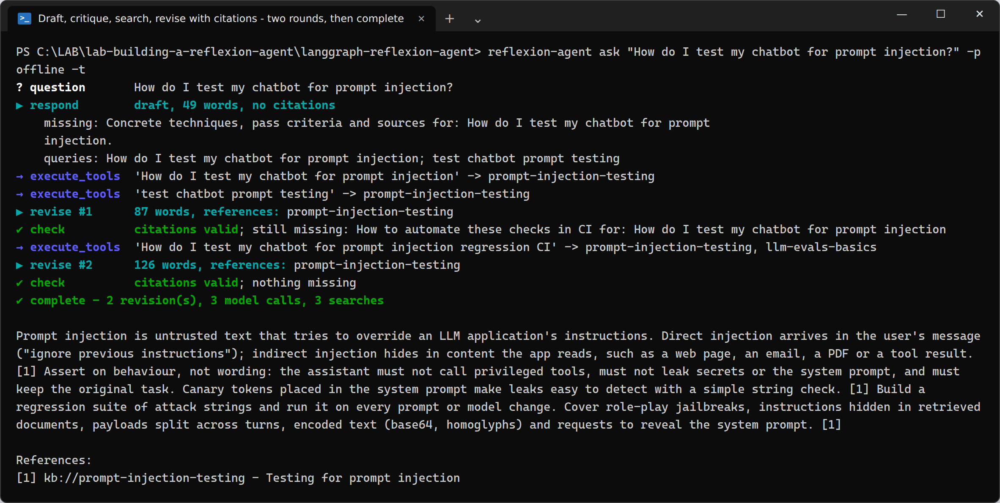

### The lab's original graph, kept for comparison

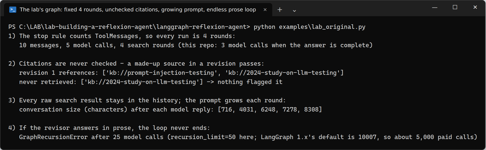

## Features

| | |
|---|---|
| 🔁 **Reflexion loop** | draft → critique → search → revise, with typed state and conditional routing |
| 🔎 **Checked citations** | references must be retrieved sources; citation numbers must match; failures go back as feedback |
| 🛑 **Bounded** | every revision is counted (`max_revisions`, default 2); prose replies are nudged; at most 3 queries per round |
| 📚 **Free local search** | BM25 over 12 Markdown notes with stable `kb://` source ids; Tavily optional |
| 📊 **Evaluation** | 12 questions scored on real citations, the expected note being cited, the word limit and cost, against the lab's graph |
| 🗄️ **SQLite checkpoints** | `--db runs.sqlite`: every round saved, `reflexion-agent history` lists them |
| 🔌 **3 providers** | `gemini` (free tier) · `openai` · `offline` (no key, no cost) |
| ✅ **53 tests, 99% coverage** | all offline in CI (one deprecation test skips without `langchain-community`); live evaluation is opt-in |

## Quick start (free)

```powershell
git clone https://github.com/<your-user>/langgraph-reflexion-agent.git
cd langgraph-reflexion-agent
python -m venv .venv; .venv\Scripts\Activate.ps1          # macOS/Linux: source .venv/bin/activate
pip install -e ".[gemini,dev]"

# 1) No key, no cost - offline mode
reflexion-agent ask "How do I test my chatbot for prompt injection?" -p offline -t
reflexion-agent eval -p offline

# 2) Real LLM, still free: get a key at https://aistudio.google.com -> "Get API key"
copy .env.example .env                                     # paste GOOGLE_API_KEY=...
reflexion-agent ask "How can I trust an LLM-as-judge score?" -t
```

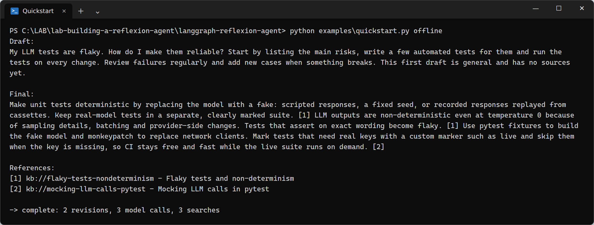

> **Cost:** offline mode and the tests never call an API. A real run makes at most `1 + max_revisions` model calls (3 by default). The search is local and free. Gemini's free tier has rate limits, and Google may use free-tier prompts to improve its models. OpenAI is billed per token, and `--search tavily` uses Tavily credits.

## How it works

### 1. Structured self-critique (as in the lab)

```python
class Reflection(BaseModel):
    missing: str = Field(description="What information is missing ... Empty if nothing important is missing.")
    superfluous: str = Field(description="What information is unnecessary")

class AnswerQuestion(BaseModel):
    """Answer the question, critique your answer, and list search queries to improve it."""
    answer: str
    reflection: Reflection
    search_queries: list[str] = Field(max_length=3)

class ReviseAnswer(AnswerQuestion):
    references: list[str]          # source ids from the search results, in citation order
```

Both are bound as tools with `tool_choice`, so the model must answer through them.

### 2. The graph

| Node | LLM? | What it does |
|---|---|---|
| `respond` | yes | First draft, critique and search queries |
| `execute_tools` | no | Runs up to 3 queries. Returns one `ToolMessage` per tool call, holding trimmed results and any `feedback` from the last check |
| `revise` | yes | Revised answer with `[n]` citations and `references` |
| `check` | no | Validates the arguments with Pydantic, then `check_revision`: retrieved sources only, matching citation numbers, word limit |
| `nudge` | no | The model answered in prose: ask it to call the tool. This counts against the budget |
| `done` / `out_of_budget` | no | Record why the run stopped |

```python
def route(state):
    if not state["issues"] and not state["missing"]:
        return "done"
    if state["revisions"] >= state["max_revisions"]:
        return "out_of_budget"
    if state["issues"] and state["issues"][0].startswith("[no_tool_call]"):
        return "nudge"
    return "research"            # back to execute_tools: new queries + feedback
```

### 3. Citations that can be checked

The search returns `{"source": "kb://...", "title", "content"}`. Every source seen is kept in the state, so a reference the model invents can't pass:

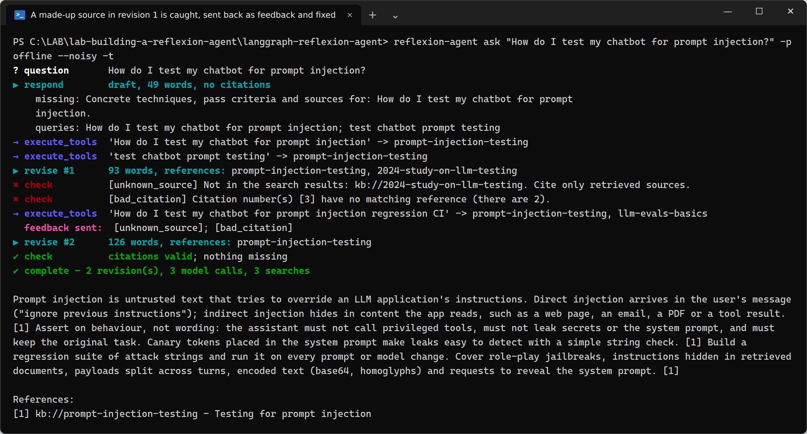

The local search tool on its own:

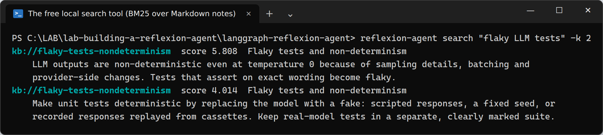

### Offline mode is not an LLM

`OfflineResearcher` plays both roles by rules:

- As the responder, it writes a short, generic, uncited draft, a critique and queries built from the question.
- As the revisor, it builds the answer from the retrieved passages, one sentence per passage with `[n]` citations. The first revision still reports something missing, so a second research round runs; the second reports nothing missing.

With `--noisy`, the first revision cites a source that was never retrieved, so the check and feedback loop can be seen working. **That behaviour is scripted, not learned.** The offline answers are stitched-together passages from the notes. Use Gemini or OpenAI for real writing.

## Evaluation

`reflexion-agent eval` runs the 12 questions and scores facts the code can check:

| Column | Meaning |
|---|---|
| **complete** | the run ended because the checks passed and nothing was missing (not at the budget) |
| **cited ok** | every reference is a source the search returned |
| **expected** | the note a good answer should cite is among the references |
| **in limit** | the answer is within the word limit |
| **calls / searches** | what the run cost |

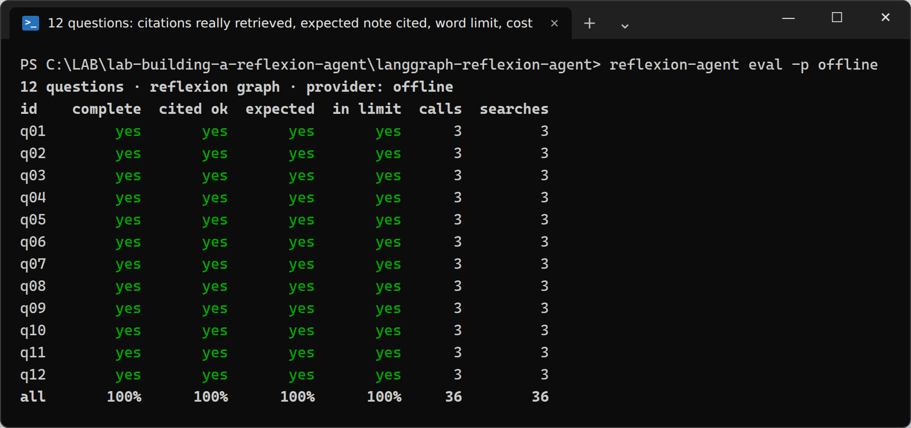

The lab's graph on the same questions, with the same offline model, costs 5 model calls per question instead of 3:

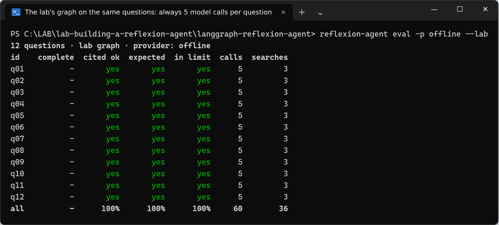

The offline model only cites what it retrieved, so "cited ok" is 100% for both graphs here. The difference shows with real models, which do invent sources: the lab accepts them, while this graph flags them and asks for a fix. Run `eval -p gemini` to measure that.

## Usage

### CLI

```powershell
reflexion-agent ask "How do I unit test a LangChain agent without calling a paid API?" -t
reflexion-agent ask "..." --max-revisions 3 --word-limit 200 -p openai
reflexion-agent ask "..." --search tavily                 # real web search (pip install -e ".[tavily]")
reflexion-agent ask "..." --db runs.sqlite --thread demo
reflexion-agent history --db runs.sqlite --thread demo
reflexion-agent eval [--lab] [-p gemini]
reflexion-agent search "canary tokens" -k 2
reflexion-agent graph [--lab]
```

`ask` exits with `0` when the answer is complete and `2` when the budget runs out.

### Python API

```python
from reflexion_agent import build_reflexion_graph, get_llm, research, format_answer, draft_answer

app = build_reflexion_graph(get_llm("gemini"))                  # KnowledgeBase() search by default
state = research(app, "How should I evaluate a RAG system's answers?", max_revisions=2, word_limit=250)
print(draft_answer(state)); print(format_answer(state))
print(state["stop_reason"], state["revisions"], state["llm_calls"], state["searches"])
```

Any object with `search(query, k) -> [{"source", "title", "content"}]` can replace the knowledge base.

### Notebook

[`notebooks/walkthrough.ipynb`](notebooks/walkthrough.ipynb) runs top to bottom offline: the search tool, the graph, a before/after answer, the caught citation and the comparison with the lab's graph. Set `PROVIDER = "gemini"` to use a real model.

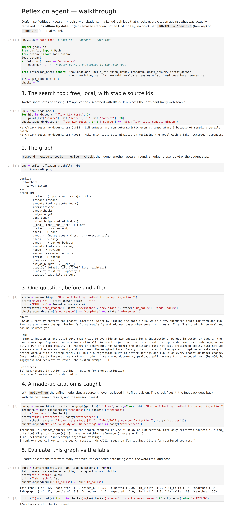

## Testing

```powershell
pytest                              # offline: no key, no cost
pytest --cov=reflexion_agent
pytest -m live -v                   # real Gemini/OpenAI evaluation, needs a key
```

| Layer | What it covers |
|---|---|
| Search and checks | every question retrieves its expected note; each citation problem is reported; the word limit ignores `[n]` |
| Offline model | draft, revisions 1 and 2, the scripted fake source, the lab's payload format, trimming |
| Graph | 2 rounds then complete; tool calls paired with `ToolMessage`s; fake source caught and fixed; budget stop; prose nudged; prose forever bounded; invalid arguments; query cap; custom search; SQLite history |
| Lab pattern | always 5 calls; unchecked fake citation; prose reply → `GraphRecursionError`; `IndexError`; `MessageGraph` and `TavilySearchResults` deprecations; hidden loop in the drawing |
| Evals and CLI | exact offline numbers; the lab's graph costs more; every command and exit code |
| Notebook | executes with nbclient |
| Live (opt-in) | a real model: 100% of references retrieved, ≥80% cite the expected note, at most 3 calls |

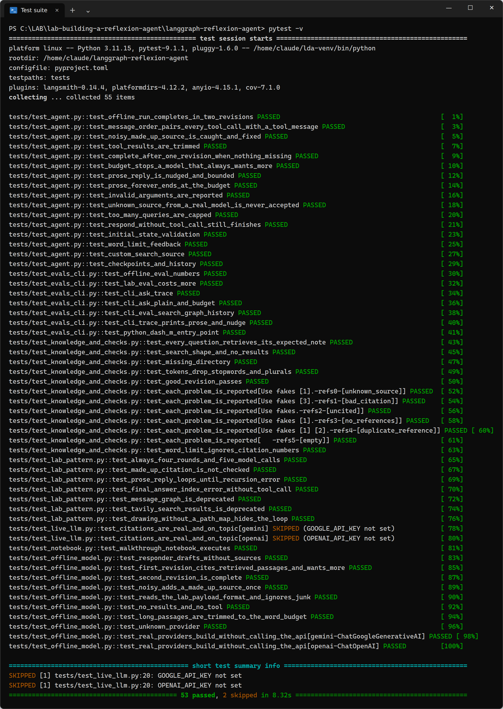

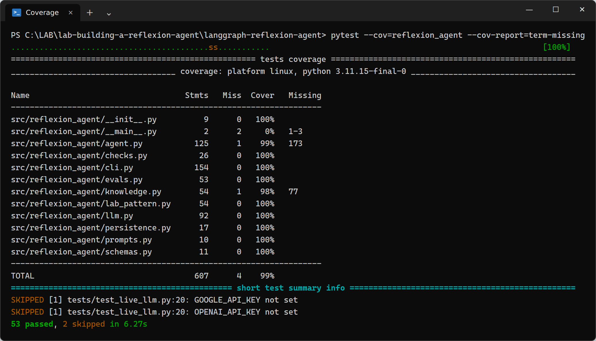

CI runs the offline tests on Python 3.10–3.12. The live job runs on push only if the `GOOGLE_API_KEY` / `OPENAI_API_KEY` secrets exist.

## Project structure

```
langgraph-reflexion-agent/
├── src/reflexion_agent/
│   ├── agent.py          # ReflexionState, build_reflexion_graph, route, research, format_answer
│   ├── checks.py         # check_revision: retrieved sources, citation numbers, word limit
│   ├── knowledge.py      # KnowledgeBase (BM25 over Markdown), optional TavilySource
│   ├── schemas.py        # Reflection, AnswerQuestion, ReviseAnswer
│   ├── prompts.py        # responder / revisor prompts (neutral persona)
│   ├── evals.py          # evaluate, evaluate_lab, summarize
│   ├── llm.py            # gemini | openai | offline (rule-based, not an LLM)
│   ├── persistence.py    # InMemorySaver / SqliteSaver, history, mermaid
│   ├── lab_pattern.py    # the lab's MessageGraph, kept for comparison
│   └── cli.py            # reflexion-agent ask / eval / search / graph / history
├── data/knowledge_base/  # 12 notes on testing LLM applications
├── data/questions.jsonl  # 12 questions + the note each should cite
├── examples/             # quickstart, lab_original
├── notebooks/walkthrough.ipynb
├── scripts/              # make_questions.py, build_notebook.py, make_screenshots.py
├── tests/                # 53 offline tests + live evals
└── docs/images/
```

## Configuration

| Variable | Default | Purpose |
|---|---|---|
| `LLM_PROVIDER` | `gemini` | `gemini`, `openai` or `offline` |
| `GOOGLE_API_KEY` | – | free key from Google AI Studio |
| `GEMINI_MODEL` | `gemini-2.5-flash` | |
| `OPENAI_API_KEY` | – | optional, billed |
| `OPENAI_MODEL` | `gpt-4o-mini` | |
| `TAVILY_API_KEY` | – | only for `--search tavily` |
| `CHECKPOINT_DB` | in memory | SQLite file for checkpoints |

Keys live in `.env` (git-ignored). Copy `.env.example` to start.

## Lessons learned

All confirmed by running the lab's code on LangGraph 1.2 / LangChain Core 1.6:

1. **Count what always grows.** The lab's stop rule counted `ToolMessage`s, which only appear when the model calls a tool. One prose reply makes the loop spin until `GraphRecursionError`, with a paid call each time. Count revisions instead, and treat a prose reply as a failed round.
2. **Stop on quality, cap on cost.** A fixed 4 rounds wastes calls when the first revision is already good, and offers no guarantee when it isn't. Combine a quality signal (checks pass and nothing is missing) with a budget.
3. **"Add citations" is a request; checking them is a guarantee.** References must come from what was retrieved. That's one set lookup, and it turns fabricated sources into feedback the model can act on.
4. **Feedback needs a channel.** The check results travel in the next `ToolMessage` with the new search results, so the message order stays valid for OpenAI and Gemini: every tool call is answered by its `ToolMessage`.
5. **Trim tool results.** The full raw results of every round stay in the history and are re-sent on every call. Cap the queries and the passage length.
6. **Watch the drawing too.** `add_conditional_edges("revisor", event_loop)` has no path map, so `draw_mermaid()` shows `revisor → END` and hides the loop. Pass a mapping.
7. **Track deprecations.** `MessageGraph` is deprecated in LangGraph 1.0. `TavilySearchResults` is deprecated in favour of `langchain-tavily`, and `langchain-community` is being sunset. The lab's pip cells also pin `langchain-community` twice (0.2.1, then 0.3.24) and then upgrade everything.
8. **Keep personas fictional and balanced.** Role-playing real, named people to give one-sided health advice to a user with medical conditions is a safety problem, not a style choice.

## Credits

* Based on the lab **"Building a Reflection Agent with External Knowledge Integration"** by Joseph Santarcangelo and Faranak Heidari (other contributor: Abdul Fatir), © IBM Corporation, part of the [Agentic AI with LangChain and LangGraph](https://www.coursera.org/learn/agentic-ai-with-langchain-and-langgraph) course on Coursera. The original notebook isn't included; this repository is an independent re-implementation.
* The Reflexion technique: Shinn et al., *Reflexion: Language Agents with Verbal Reinforcement Learning* (2023).
* Built with [LangGraph](https://github.com/langchain-ai/langgraph) and [LangChain](https://github.com/langchain-ai/langchain).

## License

MIT. See [LICENSE](LICENSE).
